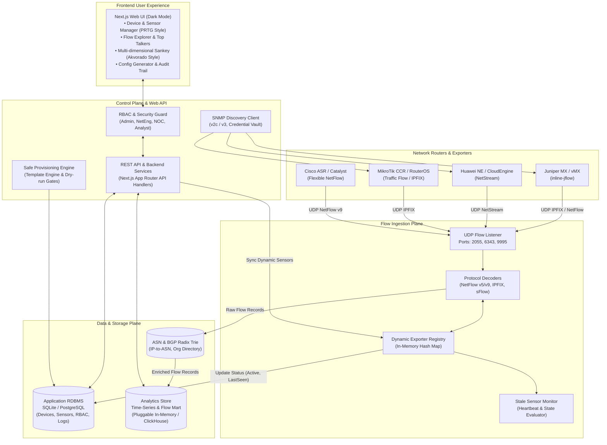
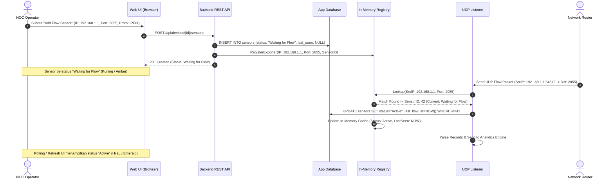
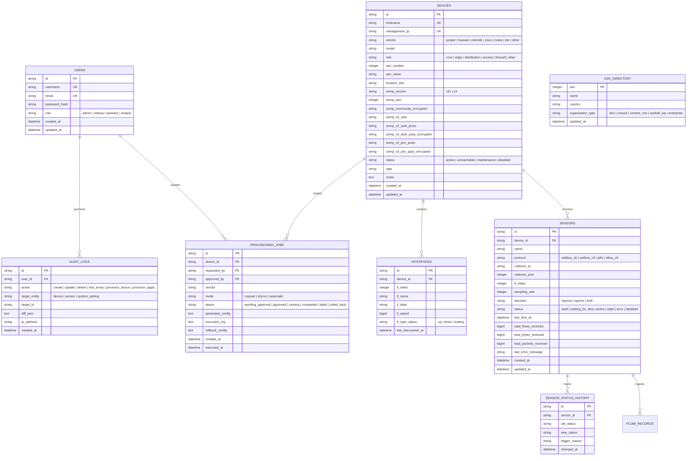
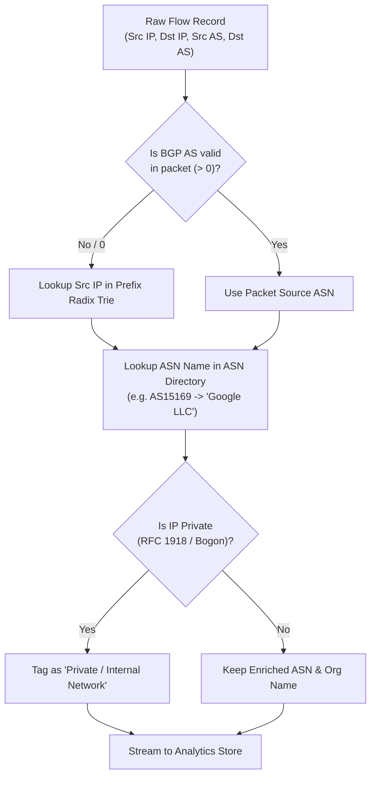

# ARCHITECTURE SPECIFICATION: JDP FLOW SENSOR MANAGER & TRAFFIC ANALYZER

**Version:** 1.0  
**Status:** Approved for Implementation  
**Standard:** Clean Architecture / Domain-Driven Modular Monolith  

---

## 1. System Overview & Component Topology

JDP Flow Sensor Manager & Traffic Analyzer dirancang dengan arsitektur modular yang memisahkan bidang kontrol web (*Control Plane*), mesin penangkap dan pemrosesan paket flow (*Data Ingestion Plane*), serta mesin analitik waktu-nyata (*Analytics & Storage Plane*).



---

## 2. Dynamic Collector Registry (Zero-Config Architecture)

Salah satu masalah utama pada alat flow tradisional (seperti flow-tools, nfsen, atau pmacct) adalah keharusan menyunting berkas konfigurasi statis (`.cfg` / `.conf`) di server collector setiap kali perangkat baru didaftarkan.

Pada sistem ini, arsitektur **Dynamic Exporter Registry** diimplementasikan sebagai berikut:



### Sensor State Machine
Status sensor diatur melalui siklus hidup yang ketat:
- **`Draft`**: Sensor baru disimpan oleh operator tapi belum diaktifkan.
- **`Waiting for Flow`**: Sensor aktif dalam registri collector, namun belum ada paket UDP valid yang diterima dari IP perangkat.
- **`Active`**: Paket flow valid diterima dan waktu kedatangan paket terakhir (`last_flow_at`) berada dalam rentang ambang toleransi (< `STALE_THRESHOLD_SECONDS`, default 180 detik).
- **`Stale`**: Sensor sebelumnya berstatus `Active`, namun tidak menerima paket baru selama lebih dari 180 detik. Status ini otomatis dievaluasi oleh background worker tanpa restart collector.
- **`Error`**: Ditemukan kesalahan parsing biner, malformed packet yang persisten, atau konflik konfigurasi.
- **`Disabled`**: Operator secara manual menonaktifkan sensor dari Web UI. Exporter dihapus dari active lookup table.

---

## 3. Database Schema & Data Models

Database metadata dirancang menggunakan model relasional yang ketat dan efisien.



---

## 4. Flow Ingestion & Decoding Engine

Modul penerima flow (`FlowCollectorService`) berjalan secara mandiri dan mendukung decoding paket biner berkecepatan tinggi:

### 4.1 Supported Wire Protocols
1. **NetFlow v5 (Fixed 24-byte Header):**
   - Header: Version (5), Count (1-30), SysUptime, UnixSecs, UnixNano, FlowSeq, EngineType, EngineID.
   - Record (48 bytes): `srcaddr`, `dstaddr`, `nexthop`, `input` (ifIndex), `output` (ifIndex), `dPkts`, `dOctets`, `First`, `Last`, `srcport`, `dstport`, `tcp_flags`, `prot`, `tos`, `src_as`, `dst_as`, `src_mask`, `dst_mask`.
2. **NetFlow v9 (RFC 3954) & IPFIX (RFC 7011):**
   - Mendukung FlowSet template dinamis dengan caching per IP exporter.
   - Ekstraksi field: Source IPv4/v6, Destination IPv4/v6, Source Transport Port, Destination Transport Port, Protocol ID, Ingress/Egress Interface, Packet Delta Count, Byte Delta Count, BGP Source ASN, BGP Destination ASN.
3. **sFlow v5 (RFC 3176):**
   - Parsing sample header flow (Ethernet, IPv4, IPv6, TCP/UDP headers) dan enterprise sample records.

### 4.2 Malformed Packet & Denial of Service Guard
- **Strict Byte Length Checking:** Setiap packet divalidasi panjang byte minimum sebelum di-slice untuk mencegah buffer overflow atau out-of-bounds exceptions.
- **Parser Isolation:** Setiap paket flow di-parse di dalam block `try-catch` terisolasi. Paket korup/malformed dicatat ke metrics error tanpa menyebabkan listener socket crash atau drop koneksi exporter lain.

---

## 5. ASN Enrichment & Interactive Sankey Engine

### 5.1 Enrichment Pipeline
Aliran paket flow sering kali hanya membawa Source IP dan Destination IP (atau ASN 0 jika router BGP exporter tidak menginjeksi AS paths). Pipeline pengayaan data bekerja secara bertingkat:



### 5.2 Sankey Aggregation Query Pattern
Untuk menjaga responsivitas browser (< 300 ms) saat me-render diagram Sankey dengan ribuan flow:
1. Backend melakukan agregasi database:
   ```sql
   SELECT 
     src_asn, src_asn_name,
     dst_asn, dst_asn_name,
     SUM(bytes) as total_bytes,
     SUM(packets) as total_packets,
     (SUM(bytes) * 8 / time_window_seconds) as bps
   FROM flow_records
   WHERE timestamp >= :start_time AND timestamp <= :end_time
     AND (:device_id IS NULL OR device_id = :device_id)
   GROUP BY src_asn, src_asn_name, dst_asn, dst_asn_name
   ORDER BY total_bytes DESC
   LIMIT 30;
   ```
2. Aliran kecil di luar Top 30 otomatis digabungkan (*grouped*) menjadi node virtual `"Other ASNs"` untuk mencegah diagram Sankey menjadi *spaghetti links*.
3. D3-Sankey SVG me-render node kiri (Source ASN), node kanan (Destination ASN / Customer Groups), dan link dengan atribut:
   - Stroke width proporsional terhadap `bps`.
   - Hover highlight pada path aliran.
   - Interactive Tooltip: menampilkan Source ASN Name, Dest ASN Name, Volume (bps & Bytes), Share percentage, dan Flow count.
   - Click node untuk langsung trigger drilldown ke tabular Flow Explorer.

---

## 6. Vendor Config Generator & Controlled Provisioning

### 6.1 Multi-Vendor Exporter Adapters
Sistem menyediakan adapter konfigurasi untuk 5 vendor router jaringan yang paling banyak digunakan di ISP Indonesia:

1. **Juniper Junos (MX / PTX / vMX):**
   ```text
   set services flow-monitoring version9 template IPv4-TEMPLATE ipv4-template
   set forwarding-options sampling instance FLOW-SAMPLING family inet output flow-server {{collector_ip}} port {{collector_port}}
   set forwarding-options sampling instance FLOW-SAMPLING family inet output flow-server {{collector_ip}} version9 template IPv4-TEMPLATE
   set forwarding-options sampling instance FLOW-SAMPLING family inet output inline-jflow source-address {{management_ip}}
   set interfaces {{interface_name}} unit 0 family inet sampling input
   ```
2. **Huawei VRP (NE40E / NetEngine / S-Series):**
   ```text
   ip netstream export host {{collector_ip}} {{collector_port}}
   ip netstream export source {{management_ip}}
   ip netstream export version 9
   ip netstream sampler fix-packets {{sampling_rate}} inbound
   interface {{interface_name}}
    ip netstream inbound
   ```
3. **MikroTik RouterOS (RouterOS v7 / CCR):**
   ```text
   /ip traffic-flow set enabled=yes interfaces={{interface_name}} cache-entries=128k active-flow-timeout=1m inactive-flow-timeout=15s
   /ip traffic-flow target add dst-address={{collector_ip}} port={{collector_port}} version=ipfix
   ```
4. **Cisco IOS-XE / IOS-XR:**
   ```text
   flow exporter EXP-JDP
    destination {{collector_ip}}
    source {{management_ip}}
    transport udp {{collector_port}}
   flow monitor MON-JDP
    exporter EXP-JDP
    cache timeout active 60
   interface {{interface_name}}
    ip flow monitor MON-JDP input
   ```
5. **Nokia SR OS (7750 SR):**
   ```text
   configure cflowd active-flow-timeout 1
   configure cflowd collector {{collector_ip}}:{{collector_port}} version 9
   configure router interface "{{interface_name}}" cflowd interface-plus
   ```

### 6.2 Security & Safety Guardrails
- **Manual Mode as Default:** Fitur generator menghasilkan script CLI yang dapat ditinjau dan disalin oleh network engineer.
- **Safe Automatic Provisioning (Opt-In):**
  - Menggunakan environment variable `ENABLE_LIVE_PROVISIONING=false` secara default.
  - Wajib melewati langkah `Dry-Run`: menampilkan syntax check dan parameter diff.
  - Memerlukan approval dari pengguna ber-role `Admin` dengan token konfirmasi.
  - Setiap eksekusi dibatasi timeout ketat (10 detik) dan mencatat seluruh output ke tabel `audit_logs` dan `provisioning_jobs`.
  - Dilengkapi generator rollback script otomatis untuk mengembalikan konfigurasi semula jika terjadi error koneksi atau timeout.

---

## 7. Security, RBAC & Protection Model

1. **Role-Based Access Control (RBAC):**
   - **`Admin`**: Akses penuh, manajemen user, approval provisioning live, konfigurasi sistem.
   - **`Network Engineer`**: Menambah/mengubah device & sensor, generate config, trigger dry-run provisioning.
   - **`NOC Operator`**: Melihat status real-time, membuat draft sensor/device, memantau alert stale.
   - **`Read-only Analyst`**: Akses analitik trafik, Top Talkers, dan diagram Sankey.
2. **Secret Management:**
   - Komunitas SNMP dan password credential disimpan terenkripsi dengan algoritma AES-256-GCM.
   - API serialization layer secara otomatis melakukan masking / omitting pada field rahasia.
   - Password atau secret token tidak pernah dituliskan ke dalam log berkas atau console trace.
3. **SSRF & Network Boundary Protection:**
   - Management IP untuk SNMP test dan provisioning divalidasi terhadap daftar blokir (e.g. `127.0.0.1`, `localhost`, link-local `169.254.0.0/16`, cloud metadata `169.254.169.254`).
   - Port koneksi dibatasi pada port standar manajemen jaringan.

