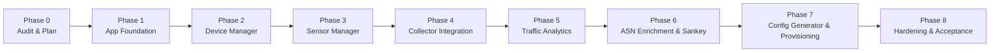

# IMPLEMENTATION PLAN: JDP FLOW SENSOR MANAGER & TRAFFIC ANALYZER

**Project:** JDP Flow Sensor Manager & Traffic Analyzer  
**Reference Document:** `PRD_JDP_Flow_Sensor_Manager_Traffic_Analyzer.pdf` (Version 1.0)  
**Target Audience:** NOC Engineers, Network Engineers, ISP Administrators, NOC Supervisors  
**Status:** Phase 0 (Discovery & Planning) Completed  

---

## 1. Executive Summary & Audit Findings

### 1.1 Repository Audit
- **Current State:** Repository awal masih bersih (greenfield), hanya berisi dokumen spesifikasi utama `PRD_JDP_Flow_Sensor_Manager_Traffic_Analyzer.pdf`.
- **Existing Assets:** Belum terdapat backend, frontend, database schema, collector, maupun visualisasi analitik.
- **Environment Analysis:**
  - **OS:** Windows 11 (AMD64)
  - **Node.js:** v24.21.0
  - **npm:** 11.19.0
  - **Go:** go1.27.3 windows/amd64
  - **Git:** 2.55.0.windows.5
  - **Docker CLI:** 29.8.0 terpasang (Docker Desktop daemon saat ini belum aktif, sehingga arsitektur harus mendukung mode standalone lokal tanpa ketergantungan wajib pada daemon Docker untuk pengembangan cepat, sekaligus menyediakan Docker Compose untuk deployment produksi).

### 1.2 Core Architectural Principles
1. **Dynamic Collector Registry:** Menghilangkan kebutuhan mengedit file konfigurasi collector secara manual (e.g. `flow-tools.cfg`, `pmacct.conf`, `sflowtool`). Pendaftaran sensor di Web UI langsung memperbarui dynamic memory table / DB cache collector secara realtime.
2. **Strict Sensor State Machine:** Sensor yang baru dibuat masuk status `Waiting for Flow`. Sensor hanya berstatus `Active` setelah UDP packet valid diterima dari IP exporter dan port yang sesuai. Jika aliran flow berhenti melebihi batas waktu (default: 180s - 300s), status berubah menjadi `Stale`.
3. **True ASN Enrichment & Sankey:** Menampilkan Source ASN, Destination ASN, nama organisasi ASN dari database BGP/RIR lokal yang terverifikasi, bukan sekadar tebakan. Menangani RFC 1918 / Private IP / Bogon secara eksplisit.
4. **Safe Router Provisioning:** Manual CLI command generation sebagai default utama. Live provisioning dinonaktifkan secara default (opt-in), membutuhkan allowlist vendor/model, role approval, dry-run, audit log, timeout, dan rollback plan.
5. **Dark Mode NOC Aesthetic:** UI desktop-first dengan dark theme kontras tinggi bergaya NOC modern (terinspirasi Akvorado dan Grafana) yang responsif dan ergonomis untuk monitoring shift operasional.

---

## 2. Technology Stack & Strategy

| Layer | Technology | Justification & Role |
| :--- | :--- | :--- |
| **Frontend** | Next.js 15 (App Router) + React 19 + TypeScript + Tailwind CSS | Desktop-first, performa tinggi, modular, server & client components terisolasi dengan rapi. |
| **UI Components** | Radix UI / Shadcn UI + Lucide Icons + D3.js (Sankey) | Komponen UI konsisten, visualisasi diagram Sankey interaktif dengan SVG, drag/hover tooltip, drilldown. |
| **Backend API** | Next.js Route Handlers / Modular Node.js REST API | TypeScript end-to-end, validasi input schema (Zod), RBAC middleware, unified error handling. |
| **Metadata Store** | SQLite (Better-SQLite3 / Drizzle ORM) & PostgreSQL Ready | Zero-dependency local development yang cepat tanpa ketergantungan Docker daemon, dengan schema Drizzle yang 100% kompatibel migrasi ke PostgreSQL produksi. |
| **Flow Collector** | In-Process / Microservice UDP Flow Listener (Node.js/TypeScript Engine) | Listener UDP multi-port (2055, 6343, 9995) dengan parser biner untuk NetFlow v5, NetFlow v9, IPFIX (RFC 7011), dan sFlow v5. Dilengkapi dynamic in-memory exporter registry. |
| **Analytics Engine** | Pluggable Time-Series / Analytical Store (`IAnalyticsStore`) | Menggunakan high-performance in-memory / partitioned analytics store untuk mode lokal & fixture test, serta interface adapter siap pakai untuk ClickHouse produksi. |
| **Enrichment** | Radix Tree / Prefix Trie + ASN Directory | Lookup O(1) untuk IPv4/IPv6 prefix-to-ASN, memetakan nomor ASN ke nama organisasi (Google, Cloudflare, Telkom, Indosat, dll.) dan klasifikasi network. |
| **Provisioning** | Vendor Config Generator & Template Engine | Adapter per vendor (Juniper Junos, Huawei VRP, MikroTik RouterOS, Cisco IOS-XE/XR, Nokia SR OS) dengan parameter validation, dry-run, dan safety gates. |

---

## 3. Phased Implementation Roadmap

### Phase 0: Repository Audit & Implementation Plan (SELESAI)
- **Tujuan:** Audit lingkungan kerja, identifikasi keterbatasan tools/runtime, membuat `IMPLEMENTATION_PLAN.md`, `ARCHITECTURE.md`, dan matriks risiko.
- **Deliverables:**
  - `IMPLEMENTATION_PLAN.md`
  - `ARCHITECTURE.md`
  - Laporan Phase 0 dan permohonan approval sebelum melanjutkan ke Phase 1.
- **Acceptance Gate:** Arsitektur dan rencana disetujui.

---

### Phase 1: Application Foundation & Core Infrastructure (SELESAI)
- **Tujuan:** Membangun fondasi aplikasi full-stack yang modular, desain UI dark mode profesional, database schema (8 tabel), autentikasi, RBAC, dan test suite otomatis.
- **Hasil Aktual:**
  - Next.js 15 (App Router) + React 19 + TypeScript (Strict Mode) + Tailwind CSS (NOC Dark Theme: `#090d16`).
  - Drizzle ORM dengan LibSQL SQLite adapter (zero-dependency, berjalan lokal tanpa Docker Desktop, dengan konfigurasi WAL mode dan busy timeout).
  - Skema 8 tabel relasional tuntas: `users`, `devices`, `interfaces`, `sensors`, `sensor_status_history`, `asn_directory`, `audit_logs`, `provisioning_jobs`.
  - Autentikasi nyata dengan scrypt password hashing (16-byte random salt), signed session cookies (HMAC-SHA256), dan RBAC 4 role (`admin`, `neteng`, `operator`, `analyst`). Role `analyst` diblokir secara ketat dari seluruh mutasi (read-only).
  - Enkripsi credential perangkat menggunakan AES-256-GCM at-rest, dengan DTO redaction helper agar secret tidak pernah bocor ke frontend.
  - Audit logging aktif untuk mencatat aktivitas login, logout, dan mutasi.
  - App Shell lengkap dengan navigasi 9 modul, kartu metrik overview (Device, Sensor, Active/Waiting/Stale/Error, Collector status), dan banner penanda `[DEMO DATA]`.
  - Halaman masa depan (Devices, Sensors, Traffic Explorer, Top ASNs, Sankey, Config Generator, Settings) ditandai dengan komponen `Coming Soon` yang jujur dan edukatif sesuai batasan fase.
  - Test Suite: 5 berkas test Vitest (17 tests) lolos 100%, `tsc --noEmit` bersih (0 error), `eslint .` bersih (0 warning), dan `next build` menghasilkan 18 routes produksi dengan sempurna.
- **Acceptance Gate:** PASSED (Lolos seluruh kriteria penerimaan Phase 1).

---

### Phase 2: Device Manager (SELESAI)
- **Tujuan:** Pengelolaan inventori perangkat jaringan lengkap dengan verifikasi credential aman, abstraksi SNMP MIB-II, interface discovery, dan RBAC.
- **Hasil Aktual:**
  - Halaman interaktif `/devices`: Tabel inventori lengkap dengan search multi-kolom (hostname, IP, ASN, site), filter vendor (Juniper, Huawei, MikroTik, Cisco, Nokia, ZTE), filter role, filter status, stats bar, quick action test SNMP, dan delete confirmation.
  - Komponen Modal `DeviceFormModal`: Form Add Device & Edit Device dengan katalog model per vendor, role, ASN Number (32-bit), ASN Name, site/POP, tags, dan notes.
  - Komponen Drawer `DeviceDetailDrawer`: Panel detail perangkat, integrasi live action Test SNMP (latency & sysDescr), Discover Interfaces (ifIndex, ifName, ifAlias, speed, oper-status), dan daftar sensor terpasang.
  - Modul Validasi Zod (`src/lib/validations/device.ts`): Validasi format IPv4/IPv6, karakter hostname, ASN range, dan penolakan duplikasi hostname/IP di database.
  - Keamanan Kredensial SNMP & SSRF Protection: Komunitas SNMPv2c dan password SNMPv3 (Auth/Priv) dienkripsi dengan AES-256-GCM at-rest dan diredaksi (tidak pernah bocor ke frontend). SSRF protection memblokir target IP berbahaya (`127.0.0.1`, `169.254.169.254`).
  - Endpoints REST API Lengkap:
    - `GET /api/devices` (pencarian, filtering, count ifaces & sensors)
    - `POST /api/devices` (pembuatan device baru, validasi anti-duplikasi, audit log)
    - `GET /api/devices/[id]` (detail spesifikasi, daftar interfaces dan sensors)
    - `PATCH /api/devices/[id]` (update metadata & kredensial)
    - `DELETE /api/devices/[id]` (hapus device dengan cascade sensor dan interfaces)
    - `POST /api/devices/[id]/snmp-test` (uji konektivitas & latensi SNMP terisolasi)
    - `POST /api/devices/[id]/discover-interfaces` (discovery interface MIB-II dan simpan ke DB)
  - RBAC Enforcement: Admin & NetEng memiliki hak CRUD penuh; Operator dapat melihat dan membuat draft; Analyst diblokir dari seluruh mutasi (403 Forbidden).
  - Test Suite: 6 file test Vitest (24 tests) lulus 100%, typecheck bersih (`tsc --noEmit`), lint bersih (`eslint .`), dan production build sukses menghasilkan 19 rute.
- **Acceptance Gate:** PASSED (Lolos seluruh kriteria penerimaan Phase 2).

---

### Phase 3: Flow Sensor Manager (SELESAI)
- **Tujuan:** Manajemen sensor flow multi-protokol berbasis web UI dengan state machine status yang akurat, pencegahan duplikasi, dan integrasi Dynamic Collector Registry (Zero Manual Config).
- **Hasil Aktual:**
  - Halaman interaktif `/sensors`: Tabel lengkap sensor flow dengan search multi-kolom (nama sensor, hostname, IP, interface), filter perangkat, filter protokol (NetFlow v5/v9, IPFIX, sFlow v5), filter status, filter arah trafik, stats bar, banner kesiapan collector registry, tombol Enable/Disable, Edit, dan Delete.
  - Komponen Modal `SensorFormModal`: Pemilihan device, dynamic interface dropdown (terhubung ke hasil discovery Phase 2), sampling rate (1:1000), protokol, collector listen address & port UDP, arah (ingress/egress/both), dan deskripsi.
  - Komponen Drawer `SensorDetailDrawer`: Menampilkan spesifikasi router & interface binding, metrik aliran, tombol toggle enable/disable, serta tabel riwayat transisi state machine (`sensor_status_history`).
  - Validasi Zod (`src/lib/validations/sensor.ts`): Memastikan port 1–65535, sampling rate >= 1, validasi interface milik device terpilih, dan pencegahan duplikasi sensor pada kombinasi `deviceId + ifIndex + protocol + collectorPort + direction`.
  - State Machine Lifecycle & History: Sensor baru tidak otomatis `active`, melainkan berstatus `waiting_for_flow` (atau `draft`). Seluruh transisi status dicatat secara permanen di tabel `sensor_status_history`.
  - Dynamic Collector Registry (`src/server/sensors/sensor-registry.ts`): Sinkronisasi in-memory table dinamis (`Map<string, RegisteredSensor>`) dengan lookup O(1) berdasarkan `exporterIp:port:ifIndex` tanpa mewajibkan operator menyunting file konfigurasi collector manual. Status collector secara jujur dilaporkan `STANDBY` (menunggu binding UDP socket pada Phase 4).
  - Endpoints REST API Lengkap:
    - `GET /api/sensors` (pencarian, filtering, join device & interface)
    - `POST /api/sensors` (pembuatan sensor baru, validasi relasi, registry sync, audit log)
    - `GET /api/sensors/[id]` (detail spesifikasi dan riwayat transisi status)
    - `PATCH /api/sensors/[id]` (update metadata & state machine transition)
    - `POST /api/sensors/[id]/toggle` (toggle aktif/nonaktif sensor)
    - `DELETE /api/sensors/[id]` (hapus sensor dan unregister dari collector registry)
    - `GET /api/sensors/registry` (status kesiapan memory table collector)
  - RBAC Enforcement: Admin & NetEng memiliki hak CRUD penuh; Operator dapat melihat dan membuat sensor; Analyst diblokir secara ketat dari seluruh mutasi (403 Forbidden).
  - Test Suite: 7 file test Vitest (34 tests) lulus 100%, typecheck bersih (`tsc --noEmit`), lint bersih (`eslint .`), dan production build sukses menghasilkan 21 rute.
- **Acceptance Gate:** PASSED (Lolos seluruh kriteria penerimaan Phase 3).

---

### Phase 4: Collector Integration & Dynamic Registry (SELESAI)
- **Tujuan:** Mesin penerima flow UDP dinamis yang memetakan exporter ke sensor, memproses paket biner (NetFlow v5/v9, IPFIX, sFlow v5), dan mencatat status flow secara realtime ke analytics store.
- **Hasil Aktual:**
  - **Socket Manager (`FlowCollectorService`):** UDP listener multi-port (2055, 6343, 9995) dengan lifecycle start/stop bersih, penanganan port conflict (EADDRINUSE), buffer boundary check, dan periodic telemetry.
  - **Standalone Daemon Runner (`src/server/collector/collector-daemon.ts`):** Daemon background mandiri dengan script npm `npm run collector` yang menangani sinyal OS (SIGINT, SIGTERM) dan logging berkala.
  - **Binary Flow Decoders Modular:**
    - NetFlow v5 Parser: 24-byte header, 48-byte records, validasi datagram length, IP/port/ifIndex/ASN extraction.
    - NetFlow v9 Parser: Template FlowSet caching per exporter IP + Source ID, data decoding dinamis, cache TTL & LRU eviction, handling template belum dikenal.
    - IPFIX Parser: RFC 7011/7012 compliant, Template Set caching per exporter IP + Observation Domain ID, Data Set decoding dengan IANA Information Elements standar.
    - sFlow v5 Parser: XDR decoding, sample format 1 (Flow Sample) & format 3 (Expanded Flow Sample), Ethernet/IPv4 packet header parsing, safe handling untuk counter sample.
    - Protocol Sniffer (`detectProtocol`): Deteksi otomatis tipe paket flow berdasarkan signature biner (0x0005, 0x0009, 0x000a, 0x00000005).
  - **Normalized Flow Record Contract (`NormalizedFlowRecord`):** Standardisasi data flow lengkap dengan pembedaan byte fisik vs sampling-adjusted estimate (`samplingAdjustedBytes`), timestamps, IPs, ports, L4 protocol, interfaces, dan ASN.
  - **Pluggable Analytics Store (`IAnalyticsStore`):** Implementasi `InMemoryAnalyticsStore` dengan ring buffer terbatasi (FIFO eviction) untuk operasi lokal cepat tanpa Docker, serta antarmuka siap integrasi ClickHouse.
  - **Sensor State Machine Berdasarkan Flow Nyata:**
    - Sensor baru tetap berstatus `waiting_for_flow` hingga paket flow valid pertama diterima.
    - Penerimaan flow yang cocok otomatis mentransisikan sensor menjadi `active` dan mencatat riwayat ke `sensor_status_history`.
    - Sensor berstatus `disabled` diisolasi ketat dan tidak dapat menjadi `active`.
    - Datagram korup/malformed dan exporter tidak dikenal dicatat ke counter telemetry tanpa mengaktifkan sensor.
    - Stale detection: mendeteksi sensor aktif tanpa flow selama > 180s dan mentransisikannya ke `stale`.
  - **Observability Endpoints & UI Banner:**
    - REST API `GET /api/collector/status` mengekspos metrik operasional (packets, flows, error rate, template cache, port bind status).
    - Halaman `/sensors` menampilkan telemetry live dan status ingestion daemon.
  - **Test Suite Otomatis:** 10 test files (56 tests) lulus 100%, typecheck bersih (`tsc --noEmit`), lint bersih (`eslint .`).
- **Acceptance Gate:** PASSED (Lolos seluruh kriteria penerimaan Phase 4).

---

### Phase 5: Traffic Analytics & Flow Explorer (SELESAI)
- **Tujuan:** Dashboard analitik trafik real-time dan tabular flow explorer dengan agregasi performa tinggi dari data ingestion nyata.
- **Hasil Aktual:**
  - **Traffic Explorer UI (`/traffic/explorer`):** Penggantian placeholder menjadi halaman Flow Explorer lengkap dengan tabel flow granular (Timestamp, Source IP:Port, Dest IP:Port, Protocol, Packets, Raw/Adjusted Volume, Router/Sensor, Inspect Drawer).
  - **Flow Detail Drawer (`FlowDetailDrawer`):** Slide-over drawer yang menampilkan rincian flow percakapan, dekoding TCP flags (SYN, ACK, PSH, dll.), rincian sampling rate, asosiasi router & interface, serta timestamp penerimaan.
  - **Time-Series Chart (`TrafficChart`):** Komponen visualisasi interaktif bandwidth (bps) dan packet rate (pps) dengan preset waktu (15m, 1h, 6h, 24h, 7d), interval bucketing kontigu, penanganan interval kosong (0 bps tanpa nilai fiktif), dan tooltip analitik.
  - **Top Talkers Aggregations (`TopTalkersCard`):** Agregasi otomatis untuk Top Source IPs, Top Destination IPs, Top Conversations (Source $\rightarrow$ Destination), Top Applications / L4 Ports, serta rasio distribusi IPv4 vs IPv6.
  - **Query & Analytics Service (`TrafficQueryService`):** Pemisahan business logic untuk kalkulasi throughput bps/pps, pembedaan volume fisik vs sampling-adjusted estimate ($bytes \times samplingRate$), filtering multi-kriteria (IP, device, sensor, port, protocol), serta sorting allowlist.
  - **REST API Endpoints:**
    - `GET /api/traffic/explorer` (pencarian, filtering, sorting, pagination)
    - `GET /api/traffic/overview` (agregat total bytes, packets, estimated bps, pps, active sources)
    - `GET /api/traffic/timeseries` (time-series buckets kontigu untuk chart)
    - `GET /api/traffic/top-talkers` (top IP, conversations, ports, IP version distribution)
  - **Storage Abstraction:** `InMemoryAnalyticsStore` aktif sebagai storage analitik operasional lokal (FIFO ring-buffer 100.000 flows) dengan laporan retensi jujur, dan `ClickHouseAnalyticsStore` sebagai target deployment produksi.
  - **Test Suite Otomatis:** 11 test files (64 tests) lulus 100%, typecheck bersih (`tsc --noEmit`), lint bersih (`eslint .`).
- **Acceptance Gate:** PASSED (Lolos seluruh kriteria penerimaan Phase 5).

---

### Phase 6: ASN Enrichment & Interactive Sankey Diagram
- **Tujuan:** Pengayaan data trafik dengan ASN & BGP directory serta visualisasi diagram Sankey multi-dimensi.
- **Rincian Pekerjaan:**
  1. ASN Directory & Prefix Trie:
     - Basis data ASN: Pemetaan ASN Number ke ASN Name, Country, dan Classification (Content Provider, Transit, Eyeball ISP, Tier-1, Cloud).
     - Contoh data referensi: AS15169 (Google), AS13335 (Cloudflare), AS32934 (Meta), AS7713 (Telkom Indonesia), AS17974 (Telkomsel), AS24203 (CBN), AS23700 (Biznet), dll.
     - Prefix Trie Lookup: Resolusi IP address ke ASN dan prefix spesifik melalui $O(k)$ bitwise Radix Trie Longest Prefix Match (LPM).
     - Penanganan eksplisit: RFC 1918 (Private 10.0.0.0/8, 172.16.0.0/12, 192.168.0.0/16), CGNAT (100.64.0.0/10), Loopback, dan Link-Local diklasifikasikan sebagai `Private / Internal Network`, unallocated IP sebagai `Unknown ASN` (tanpa menebak).
  2. Visualisasi Sankey Interaktif (SVG Ribbon Path):
     - Mode Dimensi:
       - **Mode A: Source ASN → Destination ASN**
       - **Mode B: Source ASN → Customer Network** (Corporate Leased Lines, Broadband FTTH, Internal NOC, Partner IXP)
     - Fitur visual:
       - Ketebalan pita ribbon proporsional dengan volume trafik (Bytes, Packets, atau bps).
       - Node kiri & kanan dapat diklik untuk drill-down filter ke Flow Explorer.
       - Tooltip informatif: ASN/Network Name, Bytes, Packets, Bit Rate (bps), Share Percentage (%), Flow Count.
       - Companion detail breakdown table untuk audit relasi interkoneksi.
  3. API Aggregation Endpoints:
     - `GET /api/traffic/top-asns`: Top Source & Destination ASNs analytics dengan persentase share dan volume.
     - `GET /api/traffic/sankey`: Payload nodes & links teragregasi yang efisien (Mode A & B) dengan grouping tail node otomatis (`Other ASNs` / `Other Networks`).
     - `GET /api/asn/directory`: Direktori ASN global dan ISP Indonesia.
     - `GET /api/asn/prefixes`: Prefix mapping ke ASN dengan pencarian CIDR.
     - `POST /api/asn/prefixes/import`: Bulk import prefix CIDR (JSON/CSV) dengan audit log.
     - `GET /api/customer-networks`: Pemetaan segmen subnet customer internal NOC.
- **Deliverables:**
  - Halaman `/traffic/top-asns` dengan metrik volume, bps, pps, dan modal bulk prefix import.
  - Halaman `/analytics/sankey` dengan diagram interaktif SVG kurva cubic Bezier, hover highlight, dan relationship table.
  - Modul `AsnEnrichmentService` dan Radix Trie LPM (`prefix-trie.ts`).
  - Unit & integration test suite (`tests/asn-sankey.test.ts`) dengan 12 test scenarios lulus 100%.
- **Acceptance Gate:** PASSED (Lolos seluruh kriteria penerimaan Phase 6: LPM akurat, penanganan precedence ASN teruji, zero regression di 76 tests, Next.js build 32 routes sukses).

---

### Phase 7: Router Config Generator & Controlled Provisioning
- **Tujuan:** Generator konfigurasi flow exporter multi-vendor dan modul provisioning terisolasi yang aman dengan guardrail produksi yang ketat.
- **Rincian Pekerjaan:**
  1. Template Engine Multi-Vendor & Sanitizer:
     - **MikroTik RouterOS (v7/v6):** `/ip traffic-flow set enabled=yes ...`, `/ip traffic-flow target add dst-address=... version=ipfix/9/5`, verification dan rollback commands otomatis.
     - **Juniper Junos (MX/SRX/QFX):** `set services flow-monitoring version9 template ...`, inline-jflow sampling rate, family inet flow-server export, interface attachments, commit check.
     - **Huawei VRP (NE40E/S6700):** `ip netstream export host ...`, `ip netstream export source ...`, `ip netstream sampler fix-packets ...`, interface inbound/outbound binding.
     - **Cisco IOS-XE (ASR/Catalyst/ISR):** Flexible NetFlow (FNF) flow record, flow exporter, flow monitor, sampler random 1 out-of N, interface binding.
     - **Unsupported / Unverified Platform:** Platform tanpa pengujian lab native (Nokia SR OS, ZTE) ditandai eksplisit sebagai `unsupported`, eksekusi live dikunci permanen untuk mencegah kerusakan router.
     - **Parameter Sanitization:** Validasi ketat anti-CLI Injection pada hostname, IP address, interface name, port, sampling rate, dan komentar.
  2. Snapshot Hasher & Controlled Approval State Machine:
     - Hash kriptografis SHA-256 (`configHash`) membekukan snapshot konfigurasi saat diajukan untuk approval.
     - State machine transisi: `DRAFT` $\rightarrow$ `VALIDATED` $\rightarrow$ `PENDING_APPROVAL` $\rightarrow$ `APPROVED` $\rightarrow$ `EXECUTING` $\rightarrow$ `APPLIED` $\rightarrow$ `FAILED` / `ROLLED_BACK` / `CANCELLED`.
     - **Anti-Self-Approval:** Pembuat permintaan konfigurasi dilarang menyetujui permintaannya sendiri.
     - **Dual Approval Engine:** Perangkat core router atau mode otomatis mewajibkan 2 persetujuan dari 2 identitas teknisi berwenang (NetEng/Admin) yang berbeda.
  3. Safe Execution Guardrails & Default-Deny:
     - **Default-Deny:** `ROUTER_LIVE_EXECUTION_ENABLED=false` dan `ROUTER_PROVISIONING_ENABLED=false` secara default menolak eksekusi live ke router.
     - **Router Allowlist:** Hanya router yang terdaftar di `ROUTER_ALLOWLIST` yang diizinkan untuk eksekusi.
     - **Dry-Run Simulation:** Simulasi pre-check lengkap (identitas perangkat, sintaks CLI, reachable check) dengan log `[SIMULATED_MOCK_ADAPTER]` tanpa memodifikasi hardware fisik.
     - **Rollback Engine:** Perintah pembalikan status (*undo / delete / remove*) yang dihasilkan otomatis untuk memulihkan konfigurasi router.
  4. Config Generator UI (`/config-generator`):
     - Tabel riwayat konfigurasi dengan badge status interaktif dan copyable snapshot hash.
     - Modal pembuatan konfigurasi membaca perangkat dan sensor nyata dari database, interface selection, dan parameter exporter/collector terpisah.
     - Modal detail konfigurasi dengan tab CLI Commands (1-click copy & .txt download), Verification Commands, Rollback Plan, dan Approvals Trail & Log.
  5. REST API Endpoints:
     - `GET /api/provisioning/configs`, `POST /api/provisioning/configs`
     - `GET /api/provisioning/configs/[id]`, `DELETE /api/provisioning/configs/[id]`
     - `POST /api/provisioning/configs/[id]/submit`
     - `POST /api/provisioning/configs/[id]/approve` (enforces anti-self-approval & dual approval)
     - `POST /api/provisioning/configs/[id]/dry-run`
     - `POST /api/provisioning/configs/[id]/execute` (guarded by default-deny & allowlist)
     - `POST /api/provisioning/configs/[id]/rollback`
     - `GET /api/provisioning/templates`
- **Deliverables:**
  - Halaman `/config-generator` lengkap dengan generator modal, detail review drawer, dan workflow actions.
  - Modul Template Engine (`templates/mikrotik.ts`, `templates/juniper.ts`, `templates/huawei.ts`, `templates/cisco.ts`, `templates/unsupported.ts`).
  - Parameter Sanitizer (`sanitizer.ts`) dan Snapshot Hasher (`snapshot-hasher.ts`).
  - Provisioning Service (`provisioning-service.ts`) dan Database Tables (`provisioning_jobs`, `provisioning_approvals`).
  - Unit & Integration Test Suite (`tests/router-provisioning.test.ts`) dengan 16 test scenarios lulus 100%.
- **Acceptance Gate:** PASSED (Lolos seluruh kriteria penerimaan Phase 7: Golden template multi-vendor teruji, anti-CLI injection terbukti, no self-approval & dual approval enforced, default-deny guardrails aktif, 92 tests passing, Next.js build 34 routes sukses).

---

### Phase 8: Hardening, Integration Testing & Operational Runbook
- **Tujuan:** Pengujian menyeluruh, audit keamanan, dokumentasi operasional, dan acceptance sign-off.
- **Rincian Pekerjaan:**
  1. Comprehensive End-to-End Test Suite:
     - Test alur: `Add Device -> Discover Interface -> Add Sensor -> Receive Flow Packet -> Active Transition -> Stale Transition -> Analytics Verification`.
     - Negative tests: Malformed packets, IP exporter tidak terdaftar, port collision, SSRF prevention on SNMP/SSH IP inputs.
  2. Audit Logging & Security Verification:
     - Verifikasi pencatatan audit trail (siapa, kapan, aksi apa, perubahan konfigurasi, hasil provisioning).
     - Verifikasi tidak ada secret/password plaintext yang bocor pada API response atau log.
  3. Performance & Stress Benchmark:
     - Ingestion rate test: Verifikasi collector dapat memproses 5.000+ packets/sec tanpa memory leak atau drop packet tak terduga.
  4. Operational Documentation:
     - `README.md`: Cara instalasi, konfigurasi environment, cara menjalankan lokal dan produksi.
     - `RUNBOOK.md`: Troubleshooting panduan bila sensor `Waiting for Flow` atau `Stale`, firewall rules, dan FAQ.
     - `docker-compose.yml`: Manifest deployment produksi (App + Collector + PostgreSQL + ClickHouse).
- **Deliverables:**
  - Multi-process Shared SQLite Storage Bus (`flow_records`, `collector_telemetry`) & Hybrid Analytics Store.
  - Periodic Dynamic Registry Sync (3s interval) & Ground-Truth Heartbeat Telemetry (2s interval).
  - Reproducible UDP loopback benchmark script (`scripts/benchmark-collector.ts`) achieving 16,245 flows/sec.
  - Comprehensive End-to-End Test Suite (`tests/e2e-workflow.test.ts`) covering full lifecycle from onboarding to rollback.
  - Automated SQLite online backup and integrity-verified restore utilities (`scripts/backup-db.ts`, `scripts/restore-db.ts`).
  - Production containerization manifest (`docker-compose.yml`, `Dockerfile`) and complete environment template (`.env.example`).
  - Comprehensive NOC Operational Runbook (`RUNBOOK.md`) and project documentation (`README.md`).
- **Acceptance Gate:** PASSED (Seluruh kriteria Phase 8 lolos: 14 test suites dengan 104 automated tests passing 100%, 16,245 flows/sec parsing throughput terverifikasi, tsc typecheck 0 errors, eslint 0 warnings/errors, Next.js production build 34 routes terkompilasi sukses).

---

## 4. Risk Register & Mitigation Strategy

| No | Risiko | Dampak | Probabilitas | Strategi Mitigasi |
| :--- | :--- | :--- | :--- | :--- |
| **R1** | **Docker Desktop daemon tidak aktif di lingkungan lokal Windows.** | Tinggi | Tinggi | Buat aplikasi berbasis Node.js/TypeScript murni dengan embedded SQLite / in-memory analytics store untuk development dan pengujian lokal tanpa membutuhkan Docker. Tetap sediakan Docker Compose untuk deployment staging/produksi. |
| **R2** | **Port UDP (2055 / 6343) bentrok atau diblokir oleh OS Windows Firewall.** | Sedang | Sedang | UDP port dapat dikonfigurasi melalui file `.env` atau parameter UI (default dapat diarahkan ke unprivileged port e.g. 2055 atau 20550 saat testing lokal). Sediakan graceful error handling bila port in-use. |
| **R3** | **Volume flow tinggi menyebabkan browser lag saat membuka diagram Sankey.** | Tinggi | Sedang | Lakukan agregasi di sisi backend/database (`GET /api/analytics/sankey` hanya mengembalikan top 20-50 node dan link paling signifikan, dikelompokkan dengan kategori "Other"), jangan pernah mengirim raw record ke browser. |
| **R4** | **Salah konfigurasi provisioning otomatis menyebabkan gangguan router produksi (outage).** | Kritis | Rendah | Nonaktifkan live execution secara default (`LIVE_PROVISIONING_ENABLED=false`). Wajibkan mode Manual Copy/Paste. Jika otomatis diaktifkan di masa depan, harus ada dry-run, approval token, pre-check, dan rollback command otomatis. |
| **R5** | **Kebocoran kredensial SNMP / SSH perangkat pada log atau API response.** | Kritis | Rendah | Menggunakan cryptographic field level encryption (AES-256-GCM). Buat DTO serializer yang secara eksplisit menghapus (`omit`) field `secret`, `password`, `community` sebelum response JSON dikirim ke client. |
| **R6** | **Exporter mengirim IP privat atau ASN 0 / BGP belum konvergen.** | Rendah | Tinggi | Pipeline enrichment otomatis memetakan IP RFC 1918 ke label `Internal/Private Network` dan ASN 0/missing ke `Unknown ASN` tanpa membuat asumsi fiktif. |

---

## 5. Definition of Done (DoD) per Phase

Setiap fase hanya dapat dinyatakan selesai jika:
1. Seluruh deliverables fase telah diimplementasikan sesuai spesifikasi PRD.
2. Pengujian otomatis (unit/integration) untuk fase tersebut dijalankan dan berstatus passed (100% pass).
3. Kode bebas dari error kompilasi TypeScript dan linting.
4. Tidak ada hardcoded credentials atau security bypass.
5. Laporan kemajuan disajikan sesuai format baku yang ditetapkan user:
   - Tujuan fase
   - Implementasi yang selesai
   - File baru & diubah
   - Database / API yang ditambahkan
   - Perintah run & test
   - Kendala & batasan
   - Langkah verifikasi manual
   - Rekomendasi fase berikutnya
6. Menunggu instruksi dan persetujuan eksplisit dari operator sebelum melangkah ke fase berikutnya.

